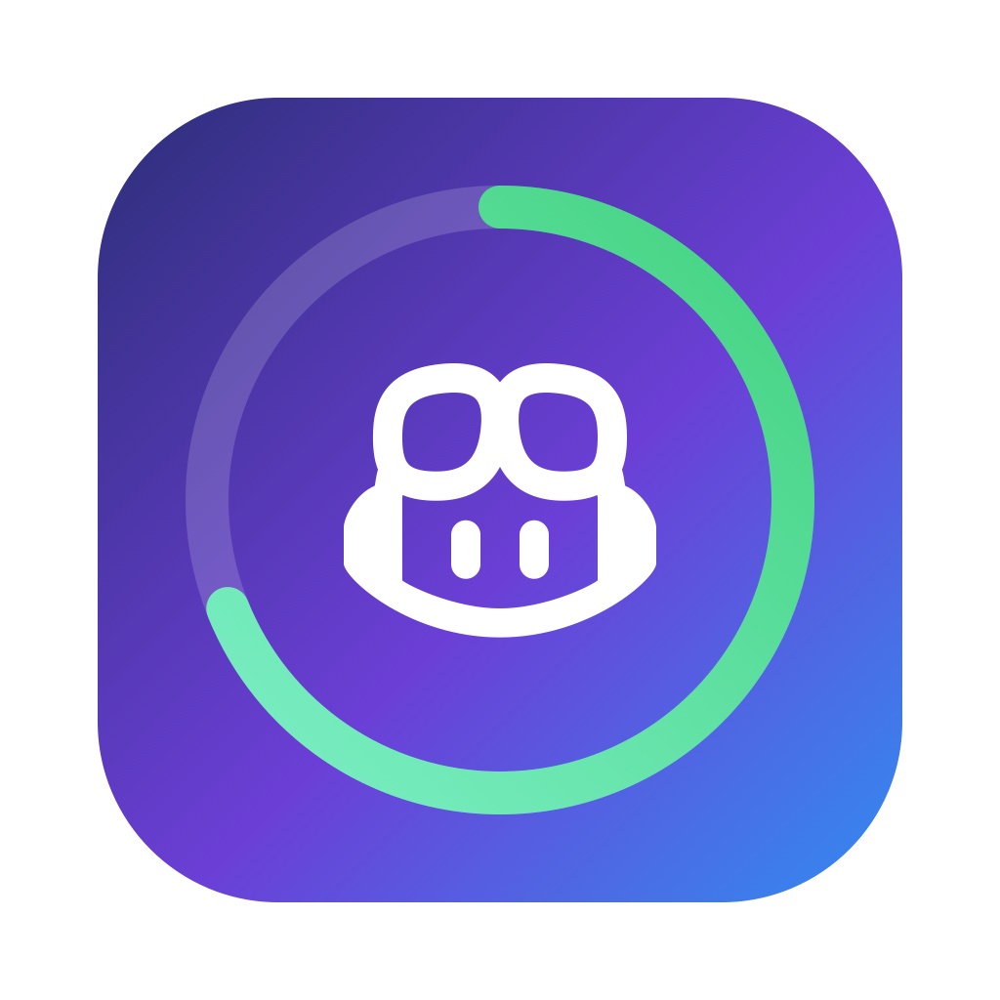
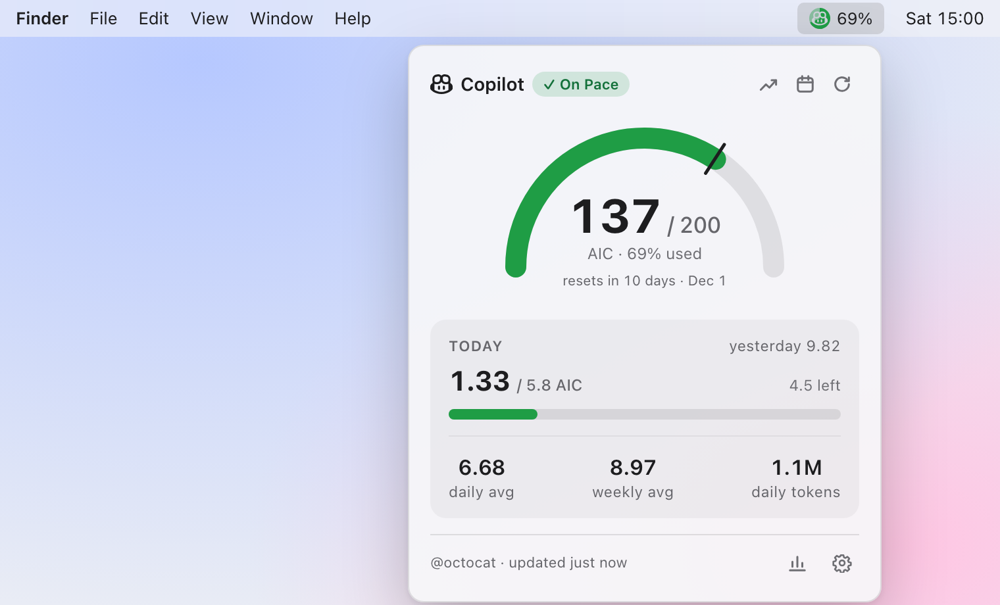
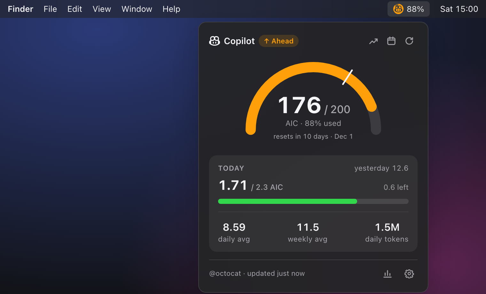
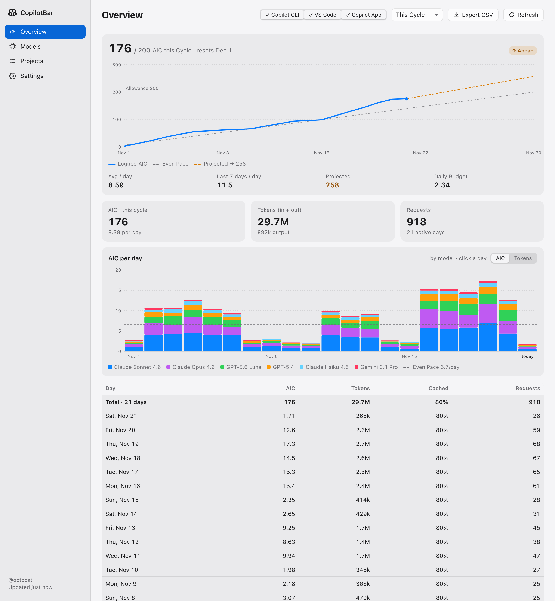
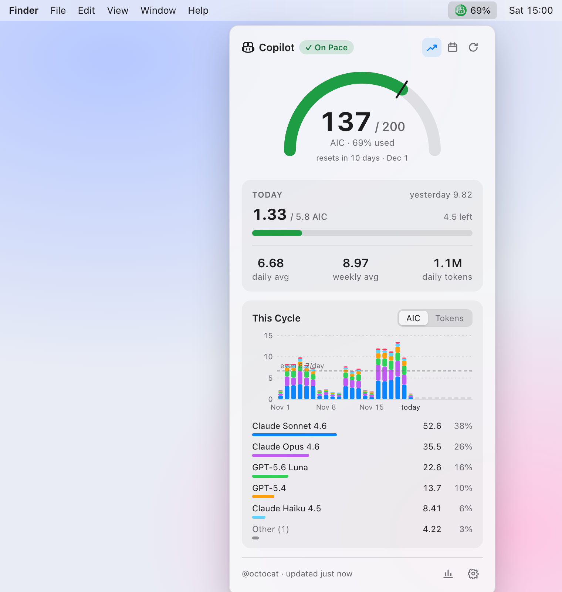
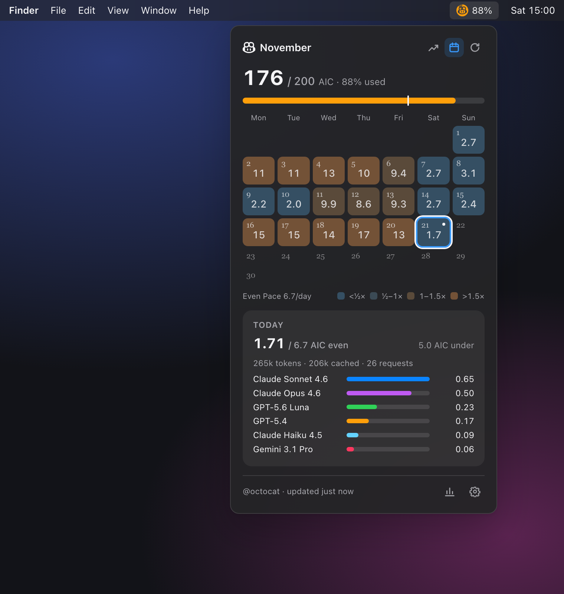
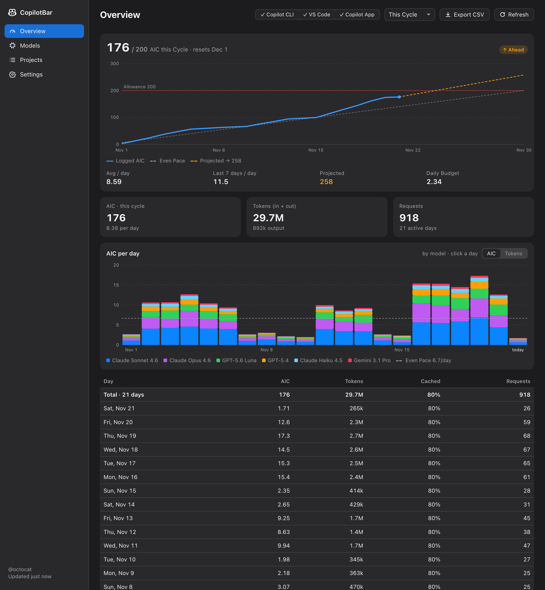
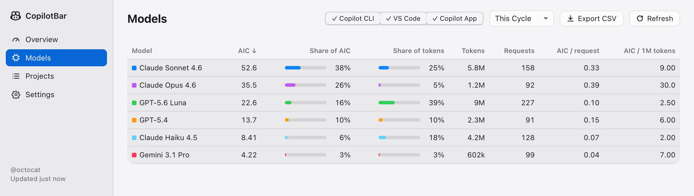
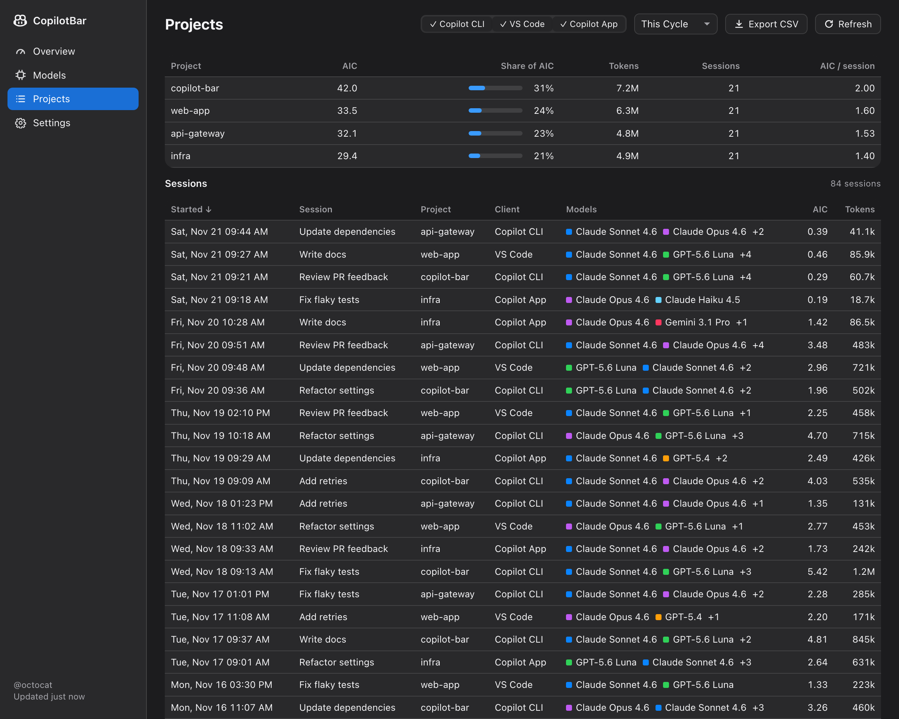
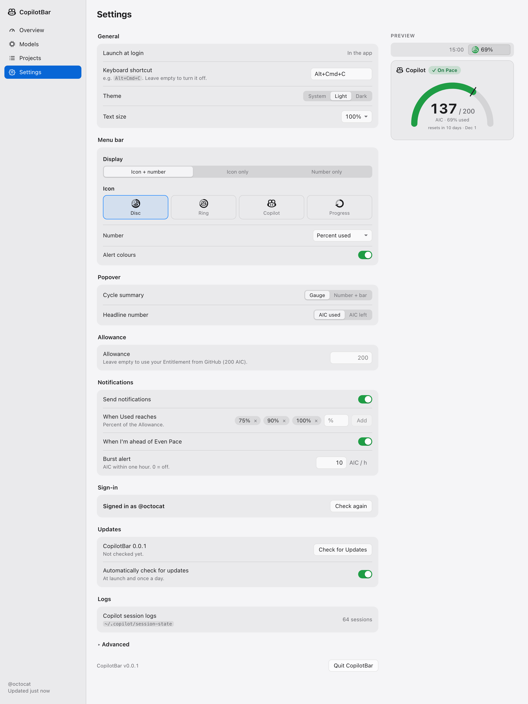

# CopilotBar

**Your GitHub Copilot usage in the macOS menu bar, read from the logs already on your Mac.**

Copilot bills in AI Credits (AIC) against a monthly limit, and GitHub only shows you one total. CopilotBar shows how much you've used this month, whether you're on pace to last until the reset, and which models, projects and sessions spent it. It reads your local Copilot logs and sends nothing anywhere.

<p>
  
  
</p>



<details>
<summary>More screenshots</summary>









</details>

## What you get

- **Usage at a glance.** A percent, AIC count or icon in the menu bar, optionally coloured green, orange or red by pace.
- **Pace, not just a total.** Whether you're under, on or ahead of an even spread to the reset, and how much you can use today.
- **Where it went.** AIC per model, per day, per project and per session, plus a calendar of the month. Runaway sessions are flagged.
- **Alerts.** Notifications at 75%, 90% and 100%, when you get ahead of pace, and when one hour burns through 10 AIC.
- **Every Copilot client on your Mac.** The Copilot CLI, VS Code's Copilot agent and the Copilot App.
- **Private by design.** No telemetry, no tokens, no Keychain. The only network traffic goes through your own GitHub CLI.

## Install

You need macOS 11+ and the [GitHub CLI](https://cli.github.com), signed in:

```sh
brew install gh && gh auth login
```

Then:

```sh
curl -fsSL https://raw.githubusercontent.com/kaanakdeniz/copilot-bar/main/install.sh | sh
```

The [script](install.sh) downloads the latest release with `gh`, checks that it was built by this repository's release workflow (`gh attestation verify`), and only then installs it into `/Applications`, or `~/Applications` if you have no admin rights. If any step fails, your current app is left as it was. Want to read it first? `curl -fsSLO https://raw.githubusercontent.com/kaanakdeniz/copilot-bar/main/install.sh`, read it, then `sh install.sh`.

After that, CopilotBar updates itself. Every update must carry a signature from this project's key.

<details>
<summary>Other ways to install</summary>

**DMG.** Download `CopilotBar_<version>_universal.dmg` from the [releases page](https://github.com/kaanakdeniz/copilot-bar/releases) and drag CopilotBar onto Applications. Releases aren't notarized, so the first launch needs **System Settings → Privacy & Security → Open Anyway**. Each release has a `SHA256SUMS` file and a build-provenance attestation you can check with `gh attestation verify <file> --repo kaanakdeniz/copilot-bar`.

**From source.** With the Xcode Command Line Tools and Node.js 22.12+:

```sh
git clone https://github.com/kaanakdeniz/copilot-bar.git && cd copilot-bar
./scripts/build-from-source.sh   # installs Rust if needed, builds, installs, launches
```

</details>

## Getting started

Click the Copilot icon in the menu bar. The welcome card shows how many Copilot sessions it found and lets you set your own monthly limit (the **Allowance**). Leave it empty to use your plan's.

- **Left-click** opens the popover; **⌥⌘C** opens it from anywhere.
- **Right-click** gives Open Dashboard, Refresh Now, Settings, Check for Updates and Quit.
- In the popover, **⌘I** shows the daily chart and models, **⌘K** the calendar, **⌘D** the dashboard.

Your usage appears within a second from the local logs. Your plan's limit and reset date come from `gh`; if `gh` isn't ready, Settings → **Sign-in** says what to run.

## How it works

CopilotBar reads `~/.copilot/session-state`, where Copilot clients log every call with its model, tokens and AIC. It adds your plan's limit, reset date and GitHub's own usage counter from `gh api copilot_internal/user`. Usage GitHub counted that isn't in your local logs (github.com, mobile, other machines, the cloud agent) shows as **Not in local logs**, so the totals still match GitHub's.

It has no network code of its own. It runs `gh` only from `/opt/homebrew/bin`, `/usr/local/bin` or `/usr/bin`, never asks for or stores a token, and sends no telemetry.

Details: [how it works](docs/how-it-works.md) · [glossary](GLOSSARY.md) · [design decisions](docs/adr/)

## Limitations

- macOS only.
- Releases are ad-hoc signed, not notarized. The install script avoids the Gatekeeper prompt; the DMG needs **Open Anyway** once per version.
- Plan data comes from an undocumented GitHub endpoint. If GitHub changes it, the limit and reset date can disappear until CopilotBar is updated. Local usage keeps working.
- Usage outside this Mac's logs has no model, token or session detail.

## Contributing

Bug reports and pull requests are welcome. See [docs/DEVELOPING.md](docs/DEVELOPING.md) to build and test, and [SECURITY.md](SECURITY.md) to report a vulnerability privately.

## License

[MIT](LICENSE). Third-party licenses are in [THIRD_PARTY_NOTICES.md](THIRD_PARTY_NOTICES.md).

CopilotBar is an unofficial tool, not affiliated with or endorsed by GitHub or Microsoft. GitHub and Copilot are trademarks of their owners.
